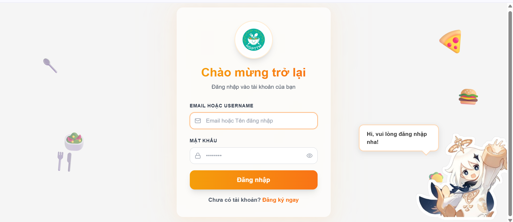
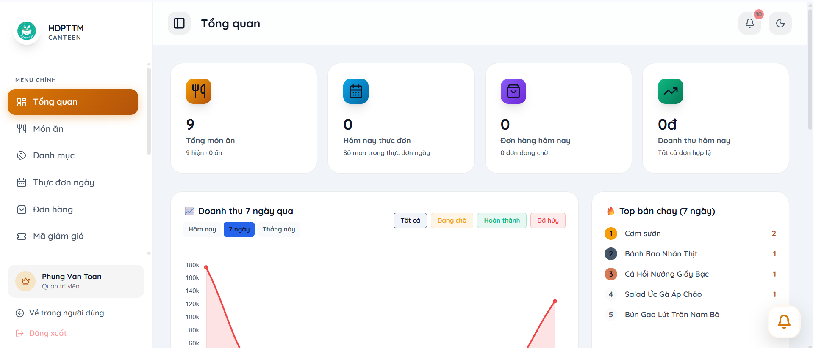
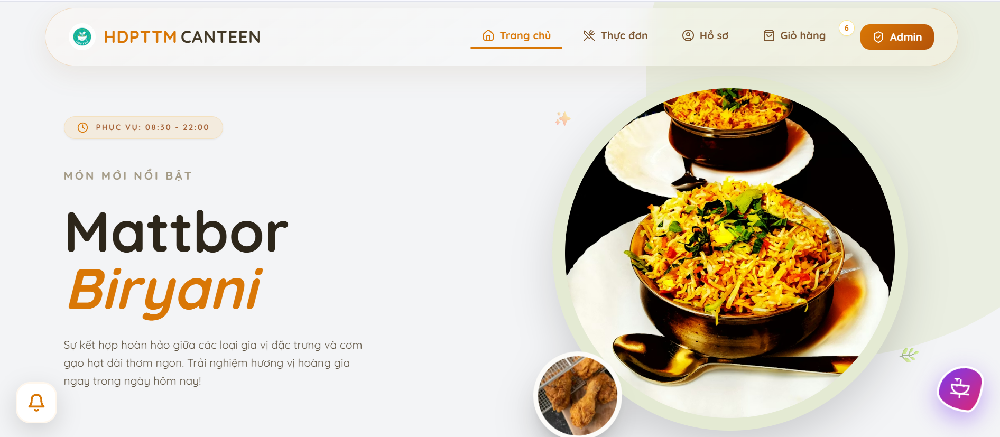

# CanTinAgile

CanTinAgile is a PHP + MySQL canteen ordering web application.

## Main Features

- User authentication: register, login, forgot password, change password.
- Product browsing and favorites.
- Cart and order flow with order note support.
- Coupon support in checkout flow.
- Payment integration with PayOS (create payment, cancel payment, webhook).
- Rating and review APIs.
- Admin pages for users, foods, categories, orders, reviews, payments, and statistics.

## Web Demo

You can try the project online at:

- `https://wexecute.com`

  
## Demo Screenshots

### Login



### Admin dashboard



### Home



## Tech Stack

- PHP 8.x
- MySQL / MariaDB
- Composer dependencies:
	- `payos/payos`
	- `guzzlehttp/guzzle`

## Project Structure

- `src/includes`: app configuration and shared helpers.
- `src/api`: backend API endpoints.
- `src/admin`: admin dashboard pages.
- `assets`: static CSS, JS, and images.
- `database`: SQL scripts and migrations.
- Root `.php` files: main user-facing pages.

## Requirements

- PHP 8.1+ with extensions:
	- `mysqli`
	- `curl`
	- `openssl`
	- `mbstring`
	- `json`
- MySQL 8+ (or compatible MariaDB)
- Composer

## Local Setup

1. Clone repository.
2. Install dependencies:

```bash
composer install
```

3. Create your local environment file.

```bash
copy .env.example .env
```

4. Create a MySQL database and import the schema.
	- Use one of the provided SQL files:
	  - `database/database.sql` (preferred)
	  - `database.sql` (legacy copy)
5. Edit `.env` with your local DB and API values:
	- `DB_HOST`, `DB_USER`, `DB_PASS`, `DB_NAME`, `DB_PORT`
	- `PAYOS_CLIENT_ID`, `PAYOS_API_KEY`, `PAYOS_CHECKSUM_KEY`
	- `PAYOS_RETURN_URL`, `PAYOS_CANCEL_URL`, `PAYOS_WEBHOOK_URL`

## Local Usage

Option 1: run the Windows helper script. This repo includes a bundled PHP runtime under `php-8.5.1-nts-Win32-vs17-x64`, so the script can work on Windows without a separate PHP install.

```bat
start_server.bat
```

Option 2: run the PHP built-in server manually.

```bash
php -S localhost:8000
```

After the server starts, open:

- `http://localhost:8000/login.php`
- `http://localhost:8000/dashboard.php` after login

If `start_server.bat` cannot find the bundled PHP runtime, install PHP locally or add it to your `PATH`, then use Option 2.

If you are using XAMPP/WAMP/Laragon, you can place the project in the web root and open it through the local Apache URL instead of the built-in server.

## PayOS Webhook

Webhook endpoint:

- `src/api/payos_webhook.php`

Configure PayOS webhook URL to your public endpoint, for example:

- `https://your-domain/src/api/payos_webhook.php`

For local testing, use a tunnel (ngrok or cloudflared) and set that public URL in PayOS.

## Security Notes

- Do not commit real secrets, API keys, or production DB credentials.
- Move sensitive config to environment variables for production.
- Keep `uploads/` writable by web server, but do not commit temporary files.

## Cleanup Done

Repository cleanup removed local logs and debug/migration helper scripts that should not be versioned. The bundled PHP runtime is intentionally kept for Windows local usage.

## License

Internal project for study/development use.
